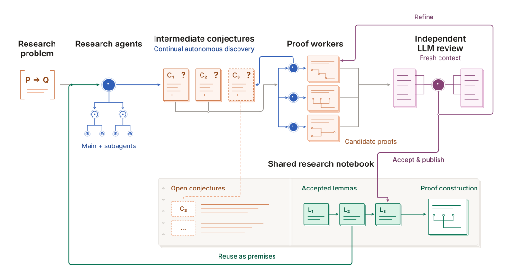

# HyProver

HyProver is an agent workflow for pure mathematics that combines broad exploration with efficient token use. As a run progresses, agents search the literature, investigate leads, reformulate problems, propose conjectures, and establish facts. They organize the work around promising routes, connecting different areas of mathematics through reformulations and proposing intermediate conjectures that advance a proof.

## How it works



## Getting started

Use a dedicated Linux environment with Python 3.10+ and a configured Codex backend. HyProver supports a Responses API endpoint you provide or sign-in with a Codex account. Follow the installation guide to configure model access, install dependencies, and start the verification service. Then start an interactive main-agent session from the repository root. [Installation guide](docs/getting-started.md)

```bash
./bin/codex
```

Give the main agent the complete problem statement, the location of any reference material, research constraints, and a budget. It can help create the project, plan proof routes, and assign work. [Operating guide](docs/operating-guide.md)

For ongoing background coordination, create a project, fill in `PROBLEM.md`, and start the project's main agent.

```bash
./bin/hyprover main start demo
./bin/hyprover main status demo
./bin/hyprover status demo --json
```

Here `demo` is the project name. Use one coordinator per project to avoid conflicting assignments. The operating guide covers pausing, resuming, the dashboard, and upgrades. [Operations guide](docs/operating-guide.md)

## Documentation

| Topic | Guide |
| --- | --- |
| Install and configure model access | [Installation guide](docs/getting-started.md) |
| Research workflow, notebook structure, and module responsibilities | [Architecture](docs/ARCHITECTURE.md) |
| Run, pause, resume, and troubleshoot a project | [Operations guide](docs/operating-guide.md) |
| Configure models, services, and permissions | [Configuration reference](docs/configuration.md) |
| Look up CLI commands and MCP parameters | [CLI and MCP tools](docs/cli-and-tools.md) |
| Connect a literature search source | [Literature search](docs/literature-search.md) |
| Turn verified results into LaTeX or PDF | [Article generation](docs/article.md) |
| Understand research roles and records | [Research roles](agents/contracts/README.md) · [Research concepts](docs/concepts.md) |
| Look up data formats, notebook interfaces, and verification endpoints | [Data model](hyprover/core/DATA_MODEL.md) · [Notebook interfaces](hyprover/core/INTERFACES.md) · [Verification service](hyprover/verify/README.md) |
| Follow a complete proof workflow | [Research notebook example](examples/README.md) |

## Acknowledgements

HyProver was developed and refined by Kaiwen Yang. Throughout development, Mingbo Gao tested HyProver and suggested improvements. Hyra assisted with parts of the development process. We thank the mathematicians and theoretical computer scientists who reviewed the test results.

## Citation

```bibtex
@software{hyprover2026,
  title  = {{HyProver}: An Agent Workflow for Pure Mathematics},
  author = {Yang, Kaiwen},
  year   = {2026},
  url    = {https://github.com/Tencent-Hunyuan/Hyra-results/tree/main/AI4Science/hyprover},
}
```

## License

HyProver's original software is available under Apache-2.0. See the repository
[LICENSE](../../LICENSE).

The bundled LaTeX template is adapted from [arXiv:2608.13536v2](https://arxiv.org/abs/2608.13536v2).
Its source and authors are recorded in the [template metadata](hyprover/article/templates/arxiv_2608_13536v2.json).
