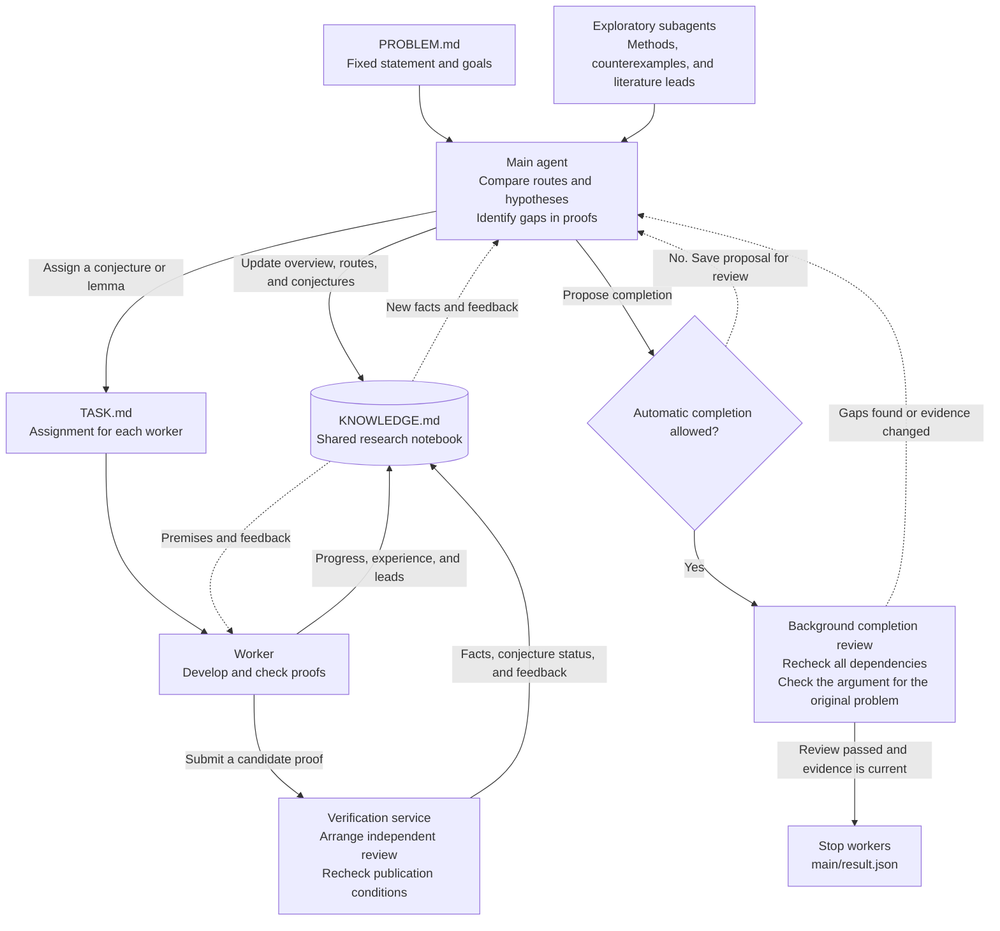
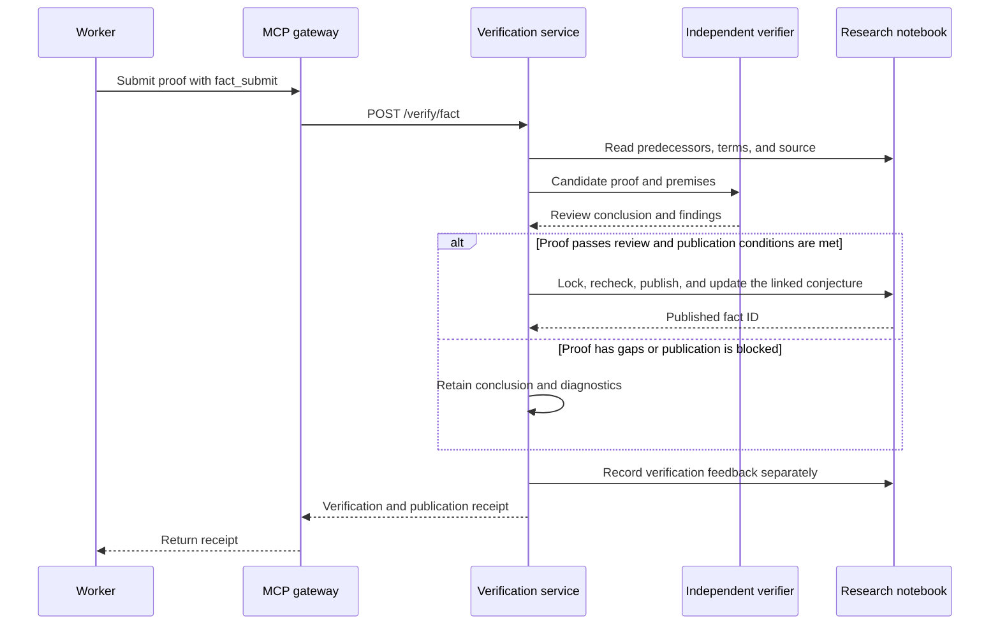

# HyProver Architecture

Every research project starts with the original problem in `PROBLEM.md`. The main agent compares proof routes, identifies gaps, and assigns tasks. Workers derive specific results, while the verification service arranges independent reviews and publishes proofs that pass. The roles share facts, progress, and feedback through the project's `KNOWLEDGE.md`. In a background run, the controller starts subsequent main-agent sessions and handles completion.

## Research Workflow

### From Proof Gaps to Tasks

The main agent connects the steps of the current argument and checks whether each step's conclusion meets the hypotheses of the next. A critical gap can be stated as an intermediate conjecture. In the `conjecture` body, specify the objects, quantifiers, hypotheses, and conclusion. In the details, explain which published facts support it and what it would contribute to the next step. A conjecture can admit several proof methods or be useful on several routes. A self-contained lemma with a clear objective can be assigned directly.

Exploratory subagents investigate constructions, counterexamples, or relevant literature. The main agent evaluates their leads and writes promising statements into workers' `TASK.md` files. Each worker starts from the current assignment, active predecessor facts, and relevant research records. They submit a complete proof or report the missing hypotheses, unfinished derivations, and work that can be picked up in the next round.

In the centroid-section example, `C001` is an intermediate statement in the construction. For each dimension `n ≥ 3`, it asks for a finite sum of odd spherical harmonics of degrees at least three on the unit sphere whose hemispherical sign transform has exactly two antipodal, nondegenerate critical points. The published fact `F010` combines three predecessors covering the critical-point construction, spherical harmonic approximation, and inversion of the transform. `V013` records its publication. [Conjecture C001](../examples/research-notebook/KNOWLEDGE.md#entry-97292e71c3b56db4) · [Fact F010](../examples/research-notebook/KNOWLEDGE.md#fact-c7fafba4b4d5a72f) · [Feedback V013](../examples/research-notebook/KNOWLEDGE.md#entry-fc339b5c03e044ca)

### Using Feedback in the Next Round

The main agent and workers read relevant reports and verification feedback each round. The main agent uses `overview` to summarize the connected proof steps and the most important remaining gap. It uses `route` to record each route's rationale, current obstacles, assignments, and conditions for resuming work. New facts can supply premises for the current route or prompt the main agent to reassign work. When a route stalls, record specific conditions that can still be checked and keep credible alternatives available.

The interactive main agent reviews credible routes every half hour and records a comprehensive audit every four hours. The background controller starts subsequent sessions according to the deployment configuration and saves each round's decision so the next can build on it. After a worker successfully finishes a round, the host checks for substantive changes to the assignment or relevant notebook entries before starting another round. [Operations Guide](operating-guide.md)

## Research Notebook `KNOWLEDGE.md`

The project's `KNOWLEDGE.md` is the shared entry point for the main agent and workers. The top of the file links to the original problem and to the notebook sections. Within each section, display labels such as `F001` help readers find records. Tool arguments and proof dependencies use the internal IDs. The table lists sections in document order. [Complete research notebook example](../examples/research-notebook/KNOWLEDGE.md)

| Section | Record types and display labels | Contents |
| --- | --- | --- |
| Overview | `overview` · `O001` | Original problem, established results, the overall proof strategy, and the most important gap |
| Verified facts | `fact` · `F001` | Complete statements, definitions, proof dependencies, and links to full proofs |
| Exploratory routes | `route` · `R001` | Proof methods, progress, reasons for pursuing each route, obstacles, and conditions for reconsidering a route |
| Conjectures | `conjecture` · `C001` | Complete open statements, related routes, and available premises. Resolved conjectures link to the published facts |
| Experience and leads | `experience` · `E001`, `lead` · `L001`, `feedback` · `V001` | Reusable experience, references and ideas to check, and results recorded by the verification service |
| Shared reports | `report` · `P001` | Progress, handoffs, blockers, next steps, and periodic audits. This section appears when reports exist |
| Revocations and history | Revoked `fact` records with their original labels | Revoked facts and affected downstream proofs, retained for reference |

In a fact record, `Depends on` lists direct predecessors and `Proof` opens the full proof under `knowledge/proofs/`. New terms are stored in the fact's `Definitions`, and definitions from active facts form the shared glossary. `Details` opens longer explanations and verification attachments under `knowledge/notes/`. Workers keep their drafts in their own `local_memory/` directories. `predecessors` records the active facts used as proof dependencies. `links` connects related routes, conjectures, reports, and other records so readers can follow the context.

### Experience Records and Reports

Use `attributes.subtype` to specify the purpose of an experience record.

| Subtype | Contents |
| --- | --- |
| `method` | Reusable methods, steps for improvement, or specific pitfalls encountered in practice |
| `boundary` | Scope of a method, unmet conditions, or limits on generalization |
| `review` | Specific questions, errors, and corrections concerning a proof, statement, or research record |

Record the current round's progress, handoffs, and routine audits as reports. When an attempt reveals a transferable method or a specific condition for its use, record it separately as experience. `review` experience and audit reports use `attributes.audits` to identify the target and its revision, the scope checked, and any areas left unchecked. [Research Concepts](concepts.md) · [Data Model](../hyprover/core/DATA_MODEL.md)

In the example, `E001` raises a specific question about the boundary having measure zero in step 6 of `F011`. The follow-up feedback explains that an earlier step established the required equality of volumes and identifies where to add a clarification. [Review experience E001](../examples/research-notebook/KNOWLEDGE.md#entry-683f18cbb33b8f19) · [Review feedback V017](../examples/research-notebook/KNOWLEDGE.md#entry-ffad014f49254883)

## From Candidate Proof to Published Fact

A worker uses the role-bound MCP tool `fact_submit` to submit a precise statement, a complete proof, and its direct predecessors. If the proof resolves an existing conjecture, copy `source_ref` from the search result to `source` in the submission. This lets the service check the conjecture's internal ID and the revision that was read. Publication requires the conjecture to remain unresolved and its normalized statement to match the candidate statement.

An independent verification session checks the derivation and can read predecessor proofs as needed. The verification service then acquires the project lock and checks that the predecessors remain active, the source conjecture's revision matches, and new definitions agree with existing terminology. `KnowledgeStore` updates the notebook atomically so that publishing the fact and marking the linked conjecture `proved` take effect together. Subsequent proofs can use the result as a published premise once the same receipt contains `accepted=true`, `published=true`, and a valid `fact_id`. If a derivation has a gap or publication is blocked, the worker uses the diagnostics to revise the proof or the assignment.

### Reviewing Published Facts

To raise a specific concern about a published fact, use `fact_review` with the fact ID, current revision, and supporting evidence. If an independent review confirms revocation, dependent proofs are invalidated and affected resolved conjectures reopen. The main agent then reassesses the relevant routes. A review can also recommend a stronger independently published result that covers all the old hypotheses and scope. Existing proofs continue to be checked against their original dependencies.

## From Target Facts to Background Completion

1. **Propose completion.** The main agent submits the published facts that cover the original problem together with the argument deriving the original goal. With `allow_early_completion=false`, the controller saves the proposal for operator review while research continues.
2. **Review independently.** The controller freezes the original problem, the target facts, and the revisions and proofs of every transitive dependency. It arranges independent rechecks and then verifies that the facts imply every objective in the original problem.
3. **Commit the result.** After the review passes, the controller confirms that the evidence revisions are still active, stops the workers, and writes `main/result.json`. Any gaps or changes in the evidence feed back into the research workflow.

The example uses `F013` as the target fact at completion. `V016` records its publication. `V018` shows how the full dependency chain and the argument for the original problem passed completion review. [Fact F013](../examples/research-notebook/KNOWLEDGE.md#fact-846e296f22ef7853) · [Publication feedback V016](../examples/research-notebook/KNOWLEDGE.md#entry-c72215b98f9c410b) · [Completion review V018](../examples/research-notebook/KNOWLEDGE.md#entry-1f7592f4059e7fcc)

The dashboard reads the notebook and shows run progress. Article generation can start from a completion result or selected published facts. It freezes the relevant evidence, generates a manuscript, and checks how its arguments correspond to the evidence. [Article Generation Guide](article.md)

## Modules

| Module | Responsibilities |
| --- | --- |
| `hyprover/orchestration/` | Project commands, background main-agent control, and sequential scheduling. [Orchestration](../hyprover/orchestration/README.md) |
| `hyprover/execution/` | Project and worker configuration, round execution, and resumption. [Execution](../hyprover/execution/README.md) |
| `hyprover/gateway/` | Role-specific MCP tools for notebook access, proof submission, and literature search. [Gateway](../hyprover/gateway/README.md) |
| `hyprover/verify/` | Independent verification, publication, fact review, and completion review. [Verification](../hyprover/verify/README.md) |
| `hyprover/core/` | Notebook format, storage, search, and proof dependencies. [Notebook Core](../hyprover/core/README.md) |
| `hyprover/integrations/` | Built-in arXiv search example. [Integrations](../hyprover/integrations/README.md) |
| `hyprover/observability/` | Read-only dashboard. [Observability](../hyprover/observability/README.md) |
| `hyprover/article/` | Article generation, evidence checks, and export. [Article Generation](article.md) |

Projects and run data are stored under `runtime/` by default. [Research Roles](../agents/contracts/README.md) · [Research Notebook Example](../examples/README.md)

## Interfaces

Start the MCP gateway with `python -m hyprover.gateway`. `HYPROVER_ROLE` selects the available tools. The verification service listens on `127.0.0.1:8091` by default. Use `/verify` for a one-off check, `/verify/fact` for proof submission and publication, and `/verify/review` for fact review. The dashboard listens on `127.0.0.1:8099` by default.

See the references for more parameters. [CLI and MCP Tools](cli-and-tools.md) · [Verification API](../hyprover/verify/README.md) · [Configuration Reference](configuration.md)
